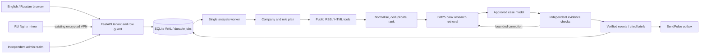

# SignalDesk

Business news intelligence that connects reported events to a company's actual context and decision role. Built for the Alfa news analytics case, with an English product, conditional Russian localisation, a separate operations console, and SubSchool's visual foundations.

**Product:** https://analytics.subschool.us · **RU mirror:** https://analytics.subschool.ru  
**Bank entry prototype:** `/alfa-business` · **Independent operations:** `/control`  
**Russian review guide:** [docs/REVIEW.ru.md](docs/REVIEW.ru.md)

## What works

- Website onboarding reads the public company website and an about page, drafts a sourced company profile, and asks the user to confirm customer segments, business exposures, geography, priorities and their decision role. Missing revenue, market share and debt terms stay unknown.
- Company profiles, sources and keywords are editable. Edits to an approved company become a draft; the published context changes only after confirmation. Events retain their company-profile version.
- Automatic and manual RSS/Atom/HTML monitoring, live source discovery based on confirmed industry, markets and actual publisher samples, diagnostics, keyword exclusions, collection schedules, duplicate suppression, and manual news/research uploads. Sources' robots policies are respected by default.
- A custom multi-step agent plans the analysis, collects evidence, ranks by company and role, retrieves dated bank research, interprets implications, independently checks the result, and performs one bounded retrieval/correction round when needed. Unsubstantiated drafts are withheld.
- Event detail separates source reporting, company relevance, conditional AI interpretation, dated bank views, next actions and uncertainties. Citations include original URLs and pages for the supplied bank PDFs.
- Dashboard with calculated metrics and charts; filters, saved signals, important-event notifications, grounded follow-up questions, and feedback.
- Daily (rolling 24h), weekly (7 days), and monthly (30 days) executive briefs cite the underlying verified events. A window without verified events gets an explicit coverage brief, never an invented market narrative. Print/PDF styles and text copying are available.
- Multiple workspaces, owner/admin/analyst/viewer access roles, separate decision roles, email-bound invitations, email confirmation and password reset. Email verification gates all workspace APIs and product routes. The public live tour has a separate guest session and read-only access to published review workspaces; a password-login jury account can run the full workflow.
- SendPulse OAuth + transactional delivery, a SignalDesk email template, user opt-in preferences, durable email outbox and bounded retries. Synthetic test recipients are never emailed.
- Separate administrator accounts and sessions, user access management, workspace/run/model-usage statistics, feedback and audit logs.

## Reproducible local launch

Requirements: Docker with Compose, or Python 3.14 and Node.js 24. Dependency versions are fixed in `backend/requirements.txt` and `frontend/package-lock.json`.

```bash
cp .env.example .env
# Set APP_SECRET to a random secret; add the provided ALFA_API_KEY.
docker compose -f compose.local.yaml up --build -d
```

Open `http://localhost:8310`. The application and a single analysis worker start together; the SQLite database lives in a named Docker volume. Local email delivery is disabled by default. To enable it, configure SendPulse and set `EMAIL_DELIVERY=sendpulse`.

For development without Docker:

```bash
python3.14 -m venv .venv
.venv/bin/pip install -r backend/requirements.txt
npm ci --prefix frontend --registry=https://registry.npmjs.org
PYTHONPATH=backend .venv/bin/uvicorn app.main:app --port 8010
# In another terminal:
npm run dev --prefix frontend
```

Open `http://127.0.0.1:5173`. For this Mac checkout, generated frontend dependencies/build files and the Python environment use the external disk; these local symlinks are ignored by Git. Docker builds run on the deployment host, not in a local VM.

## Configuration

| Variable | Purpose |
|---|---|
| `APP_SECRET` | 32+ random characters; encrypts private model credentials. Preserve it across deploys. |
| `ALFA_API_KEY` | Server-side case key. Stored as a GitHub Actions secret; never shipped to the browser. |
| `ALFA_BASE_URL` | Default `https://changellenge.up.railway.app/v1`. |
| `ALFA_FALLBACK_URL` | Network fallback `https://api.alfahack-gateway26.ru/v1`. |
| `ALFA_MODEL` | Default generation model `qwen/qwen3.6-35b-a3b`. |
| `ALFA_REVIEW_MODEL` | Independent checker `google/gemma-4-26b-a4b-it`, through the same approved gateway. Must be an approved model ID. Private custom endpoints use their selected model. |
| `MODEL_DAILY_TOKEN_LIMIT` | Local global token guard in addition to the upstream shared budget; default 1,500,000. |
| `DATABASE_URL` | SQLite by default. Production points at `/data/signaldesk.sqlite`. |
| `PUBLIC_URL`, `ALLOWED_ORIGINS` | Public links and the exact allowed browser origins. |
| `COOKIE_SECURE`, `APP_ENV` | Production requires secure cookies and a strong application secret. |
| `SENDPULSE_ID`, `SENDPULSE_SECRET` | SendPulse OAuth credentials. |
| `EMAIL_FROM`, `EMAIL_DELIVERY` | `maksim@subschool.us`; `disabled` or `sendpulse`. |
| `ADMIN_EMAIL`, `ADMIN_PASSWORD` | Bootstrap an independent administrator once. No default administrator password exists. |
| `WORKER_ENABLED` | Enable the single durable analysis worker; disable for deterministic CI. |

The case gateway exposes only the six approved model IDs in the default selector. The workspace owner can configure a generic private OpenAI-compatible endpoint, model ID and write-only API key for development or organisational use. No other provider or model is hardcoded. Use **Hackathon · approved models** for case evaluation. Custom keys are encrypted with Fernet and excluded from API responses, logs and exports.

The production local guard is 3,000,000 tokens per UTC day, with historical preparation usage retained; the development default is 1,500,000. The gateway’s shared monetary budget remains the hard upstream limit. The case budget is shared and resets at **03:00 Moscow time**. A budget/rate-limit error preserves existing research and collected evidence and produces a visible failed run with a retry action. No synthetic conclusions are substituted for a failed model call.

## Architecture



FastAPI/SQLAlchemy, Vue 3/Vite, Chart.js, and Lucide icons. The agent is implemented in this repository; there is no third-party autonomous agent or orchestration framework. The original bank files are OCRed into a page-indexed, checksummed corpus. Retrieval uses a small bilingual BM25 index with query expansion and document diversification, rather than an external embedding service.

Core relational records are users, independent administrators, sessions, workspaces, memberships, jobs, model usage and audit events. Versioned workspace items hold source definitions, evidence, events, briefs, feedback, notifications and invitations. All product access verifies workspace membership on the server; browser workspace IDs do not grant access.

Production runs one app process and one in-process worker on a persistent volume. SQLite WAL is appropriate for this deployed single-host prototype. To scale horizontally, move the records to PostgreSQL, add transactional job claims/leases and separate workers, replace corpus scans with a maintained search index, and apply workspace quotas and retention policies. Those multi-host changes are an architecture path, not a claim that this prototype already provides distributed execution or high availability.

## Evidence and company data

- `data/bank/*.json`: nine actual bank research documents linked by the case, with original URLs, SHA-256 values, OCR flags and page text. Document dates and reporting-period precision are preserved; the 2021 steel report is explicitly historical.
- `data/demo_clients.csv` and `data/demo_payments.csv`: a small anonymised case sample for reproducing client-feature and payment-link import. This sample is not a mapping to a real company.
- Public review workspaces contain actually collected publications and approved-model analyses. The anonymised manufacturing company has no invented public identity or website. `backend/tests/fixtures.py` is synthetic test data only; it is excluded from the Docker image and never imported by the application.
- `scripts/prepare_live_review.py` prepares genuine review workspaces; `ops/import_review.py` imports them idempotently using private credentials supplied over stdin. No credentials or generated review bundles are committed.
- `scripts/fetch_case_data.py` and `scripts/ocr_case_research.py`: resource acquisition/OCR helpers. Raw full case CSVs and downloaded PDFs stay in ignored local storage. OCR regeneration additionally requires Pillow, Tesseract and Russian/English trained data.

Manual uploads accept searchable PDF, TXT, Markdown, HTML and CSV, up to 10 MB. CSV import provides up to 2,000 rows per file and exposes the limit. Scanned PDFs without text require OCR before a new manual upload; the supplied scanned case corpus is already OCRed. Source access failures, unknown dates, limited headline evidence and unconfirmed company inputs remain visible.

## Source discovery and access

The website draft never silently subscribes a new company to a fixed outlet list. A durable discovery job uses confirmed markets/activities to query public indexes, researches publisher websites, discovers advertised feeds and actually collects sample publications. The approved model ranks only verified source IDs. Search provenance, verification date, sample headlines and coverage gaps are retained. GDELT, DuckDuckGo and MediaWiki availability varies; blocked/challenged indexes are recorded, never bypassed. Model-proposed publisher homepages are explicitly unverified leads until their public pages and samples pass checks. Old promotional archives are rejected. No recommendation is better than unrelated regional coverage. Manual source setup remains available.

Unverified accounts can read their limited account state and request another verification email; workspace APIs return 403. A one-time verification link also signs in a different browser and restores an email-bound invitation. Guest and product cookies are independent, so exploring the tour does not replace a signed-in account. Tour visitors cannot mutate sources, profiles, roles, saved events, invites or model settings. Owner-selected published review context is readable; private user workspaces are never included.

## Language rules

English is the default. A Russian switch is shown only when the browser's **primary language** starts with `ru`, or the hostname is exactly `analytics.subschool.ru`. Russian defaults in either case. An eligible user can then choose English. Other visitors always see English without a Russian switch. No IP geolocation is used.

## Checks

```bash
.venv/bin/python -m pytest backend/tests -q
npm run build --prefix frontend
npm exec --prefix frontend -- playwright install chromium
node scripts/e2e.mjs
# Optional paid live-model and real-source checks, using the server-side case key:
RUN_LIVE_E2E=true node scripts/e2e.mjs
PYTHONPATH=backend .venv/bin/python scripts/evaluate_case.py
# Public deployment and locale/authentication smoke check:
node scripts/smoke_deployed.mjs
```

The deterministic tests cover session separation, cross-tenant access, role restrictions, invitations, SSRF including DNS rebinding, origin checks, private-key redaction, profile approval/versioning, evidence rejection, bank page provenance, brief windows and empty periods. Browser checks exercise both companies, English/Russian rules, mobile reflow, source/trace navigation, registration/onboarding, invitation acceptance, viewer restrictions and the independent operations interface. Live mode also checks all brief periods, company website extraction, actual collection/RAG/interpretation/verification and grounded questions.

Browser artifacts and JSON results are in ignored `output/playwright/`; the review record is [docs/QUALITY.md](docs/QUALITY.md). A screenshot audit is in [docs/DESIGN_AUDIT.md](docs/DESIGN_AUDIT.md).

## Deploy and operate

The main server runs `compose.yaml` on the existing `caddy_net`, with an isolated container and volume. Its Caddy drop-in is `ops/signaldesk.caddy`. The RU server uses `ops/analytics.subschool.ru.conf`, terminates its own HTTPS certificate, and proxies over the existing VPN to the same database-backed app. Authentication data is consistent across domains; browser cookies remain host-scoped, so sign in separately on each domain.

GitHub Actions runs checks and deploys commits to `main`. Deployment secrets: `ALFA_API_KEY`, `APP_SECRET`, `SENDPULSE_ID`, `SENDPULSE_SECRET`, `ADMIN_EMAIL`, `ADMIN_PASSWORD`, `PROD_SSH_KEY`, `RU_SSH_KEY`. The runtime environment is rendered through a pipe into a mode-0600 server file. Product credentials are handed to the owner privately and are not in Git.

The remote deployment script builds a tagged image, takes a consistent SQLite backup before updates, checks health, and can return to the previous image on a health failure. `ops/backup.py` retains 14 consistent snapshots on the app volume. These are local recovery copies; off-host backup is a separate infrastructure policy. An administrator can also export a workspace from the product. Do not run multiple Uvicorn workers against this scheduler.

Health: `/api/health` · API schema: `/openapi.json` · interactive API: `/docs`. User and admin interfaces are no-indexed. On restarts, interrupted analyses become explicit failures that can be retried, not silently published partial insights.

For a private hackathon repository, the owner must grant the designated jury account `alfa-hack-2026` access before submission. Record the final release tag/commit when submitting. See [THIRD_PARTY_NOTICES.md](THIRD_PARTY_NOTICES.md) for components, services, models, case data and simulated integration boundaries.
