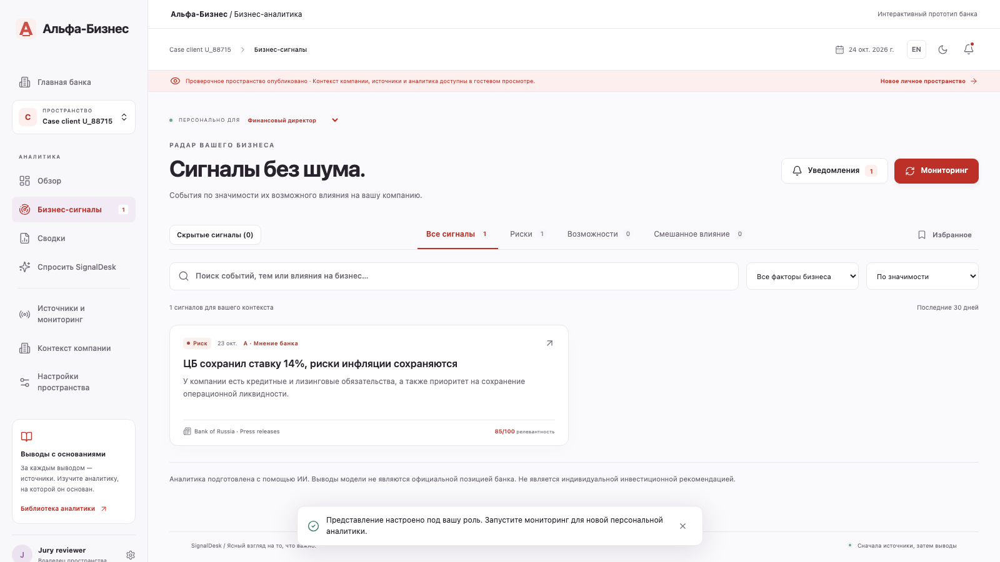

# SignalDesk

**Personalised business news intelligence for company decision makers.**

SignalDesk combines external reporting, a reviewed company profile and dated Alfa-Bank research to explain why an event matters, which business assumptions need checking and what the user can do next. The working prototype includes an Alfa-Business entry flow and a complete research-to-decision workflow.

[Open the product](https://analytics.subschool.ru) · [Watch the 2:51 demo](https://youtu.be/gzwKJkbbmH4) · [Russian review guide](docs/REVIEW.ru.md) · [Case-data analysis](docs/CASE_ANALYSIS.ru.md)



## Review the deployed solution

1. Open [the Alfa-Business entry](https://analytics.subschool.ru/alfa-business). The banking shell is an interactive prototype; no banking SSO, accounts or payment execution are connected.
2. Use the read-only live tour to inspect actual collected publications and model analyses. The separate jury login uses the same review workspaces with product permissions; credentials are shared privately.
3. Select **Case client U_88715**, then the **CFO** decision role. Read the interest-rate event, company link, next actions and unknowns.
4. Open the original news and the dated bank excerpt. The source fact, bank position and model interpretation are labelled separately.
5. Inspect source collection and agent runs, generate an executive brief, or ask a follow-up question. Generation requires a signed-in, verified account and an available model budget.
6. Switch to **EduHub** or **SubSchool** to inspect another industry/market context. Test data and deployed review data have distinct provenance.

## Run locally with Docker

Requirements: Git, Docker Engine/Desktop with Compose v2, and a valid organiser gateway key for live AI generation. Docker pins Python 3.14 and Node.js 24 major versions; dependencies are locked in `backend/requirements.txt` and `frontend/package-lock.json`.

```bash
git clone https://github.com/SubSchoolLTD/news.git
cd news
cp .env.example .env
```

Set `APP_SECRET` in `.env` to a new random value, for example one generated by `python3 -c "import secrets; print(secrets.token_hex(32))"`. Set `ALFA_API_KEY` to your authorised key. Keep `.env` private.

```bash
docker compose -f compose.local.yaml up --build -d
```

Open **http://localhost:8310**. One API process and one durable analysis worker run together. SQLite data persists in the `signaldesk_data` volume. A fresh installation contains the supplied bank-research corpus, but no pre-generated company news or universal password.

**Local account without SMTP.** Development email is disabled by default. Create a verified local reviewer from the container console and choose a password when prompted:

```bash
docker compose -f compose.local.yaml exec app python ops/bootstrap_local_user.py --email reviewer@example.test
```

Sign in with that email/password, complete the company onboarding and run monitoring. This console command refuses production environments and never changes an existing account. Production registration always requires email confirmation. To test the actual email flow, configure SendPulse and set `EMAIL_DELIVERY=sendpulse` instead.

```bash
# Inspect readiness and worker logs
curl http://localhost:8310/api/health
docker compose -f compose.local.yaml logs --tail=100 app
# Stop while preserving the named data volume
docker compose -f compose.local.yaml down
```

### Check the case workflow locally

After signing in, create a workspace and open **Company context**. Import `data/demo_clients.csv` and `data/demo_payments.csv`, select `U_88715`, review the company facts and confirm the profile. These files are a small anonymised subset supplied with the case, not a generated news feed. Upload limits are 10 MB and 2,000 rows per CSV.

Add a public news RSS/HTML source, run monitoring, inspect the evidence in a published event, then generate day/week/month briefs and ask a source-grounded question. Automatic source discovery verifies publisher pages, advertised feeds and real sample publications against the confirmed industry and markets. Search failures and coverage gaps remain visible. No unsupported response or synthetic news is substituted for a failed model call.

## Features

- Reviewed onboarding from a public company website or manual/case-data input. Unknown revenue, market share, geographic exposure and contract terms stay unknown. Approved profiles are versioned.
- Automatic and manual RSS/Atom/HTML collection, source discovery, schedules, keyword exclusions, deduplication, diagnostics and research uploads.
- Company- and role-aware ranking, source-backed interpretations, dated bank quotations, concrete next steps and visible uncertainty.
- A custom multi-step agent with planning, tools, retained evidence context, independent review and one bounded retrieval/repair round. Unsupported drafts are withheld.
- Executive dashboard, filtering, saved/hidden signals, feedback, important-event notifications and evidence-grounded follow-up questions.
- Rolling 24-hour, 7-day and 30-day briefs. Empty periods produce an explicit coverage statement. Briefs support print/PDF and text copying.
- Multiple workspaces, email-bound invitations, owner/admin/analyst/viewer permissions and separate business decision roles. Email confirmation gates product APIs.
- Independent operations accounts at `/control`, user/run/usage statistics and audit records.
- SendPulse opt-in alerts and briefs with a durable outbox and bounded retries.
- English UI with Russian available for a Russian browser or the Russian product URL.

## Architecture

| Layer | Implementation |
|---|---|
| Product and operations UI | Vue 3, TypeScript, Vite, Chart.js, Lucide |
| API and access control | FastAPI, server-side workspace membership/RBAC, separate product/guest/admin sessions |
| Persistence and scheduling | SQLAlchemy, SQLite WAL, durable jobs, one in-process worker, email outbox |
| News tools | Public RSS/Atom/HTML fetch, checked DNS/network targets, deduplication and diagnostics |
| Bank retrieval | Page-indexed OCR corpus of 9 supplied reports, bilingual BM25 retrieval, dates/URLs/checksums |
| Interpretation and review | Approved Qwen generator and independent Gemma checker through the organiser gateway, structured contradiction checks, bounded correction |
| Delivery | Event feed, dashboard, briefs, follow-up answers, SendPulse notifications |

The agent and its orchestration are implemented in this repository. No ready-made autonomous agent service, external embedding service or additional named model provider is required. A generic private OpenAI-compatible adapter is available for organisational development; use **Hackathon · approved models** for case evaluation.

The deployed prototype uses one app process and a persistent SQLite volume. Horizontal scaling would require PostgreSQL, transactional job leases, separate workers, a maintained retrieval index and off-host recovery. These are next-stage changes, not features claimed for this single-host prototype. See [implementation details](docs/IMPLEMENTATION.md) and [third-party notices](THIRD_PARTY_NOTICES.md).

## Configuration

| Variable | Purpose |
|---|---|
| `APP_SECRET` | Random 32+ characters. Encrypts private model credentials; preserve across restarts. |
| `ALFA_API_KEY` | Authorised server-side case key. Never exposed to the browser. |
| `ALFA_BASE_URL` | Organiser gateway, default `https://changellenge.up.railway.app/v1`. |
| `ALFA_FALLBACK_URL` | Gateway network fallback from the supplied API instructions. |
| `ALFA_MODEL` | Default `qwen/qwen3.6-35b-a3b`. |
| `ALFA_REVIEW_MODEL` | Independent checker, default `google/gemma-4-26b-a4b-it`. |
| `MODEL_DAILY_TOKEN_LIMIT` | Application token guard, default 1,500,000. Upstream shared budget is separate. |
| `DATABASE_URL` | SQLite connection. Docker local configuration uses `/data/signaldesk.sqlite`. |
| `PUBLIC_URL`, `ALLOWED_ORIGINS` | Public links and exact allowed browser origins; local Compose overrides these. |
| `APP_ENV`, `COOKIE_SECURE` | Production requires `APP_ENV=production`, secure cookies and a strong secret. |
| `EMAIL_DELIVERY` | `disabled` by default or `sendpulse`. |
| `SENDPULSE_ID`, `SENDPULSE_SECRET`, `EMAIL_FROM` | SendPulse OAuth and a verified sender for live email. |
| `ADMIN_EMAIL`, `ADMIN_PASSWORD` | Optional one-time bootstrap of an independent administrator; no default admin password. |
| `WORKER_ENABLED` | Enable the single durable worker. Disable for deterministic tests. |

Budget/rate-limit errors preserve collected evidence, expose a failed run and allow retry. No measured expert-accuracy percentage is claimed. The quality process and its limitations are in [QUALITY.md](docs/QUALITY.md).

## Development and tests

Without Docker, install Python 3.14 and Node.js 24:

```bash
python3.14 -m venv .venv
.venv/bin/pip install -r backend/requirements.txt
npm ci --prefix frontend --registry=https://registry.npmjs.org
# In one terminal:
PYTHONPATH=backend .venv/bin/uvicorn app.main:app --port 8010
# In another terminal:
npm run dev --prefix frontend
# With SMTP disabled, bootstrap your local reviewer:
.venv/bin/python ops/bootstrap_local_user.py --email reviewer@example.test
```

Open `http://localhost:5173`. API schema: `/openapi.json`; interactive API: `/docs`; readiness: `/api/health`.

```bash
mkdir -p .local
.venv/bin/python -m pytest backend/tests -q
npm run build --prefix frontend
npm exec --prefix frontend -- playwright install chromium
# Run with local API/Vite servers, WORKER_ENABLED=false, APP_ENV=test and mail disabled:
E2E_PYTHON=.venv/bin/python node scripts/e2e.mjs
# Optional paid live-model/real-source checks on an isolated local database:
RUN_LIVE_E2E=true E2E_PYTHON=.venv/bin/python node scripts/e2e.mjs
# Read-only deployed smoke checks:
node scripts/smoke_deployed.mjs
```

The deterministic browser suite creates synthetic fixtures locally. It cannot seed a public deployment, and the fixtures are excluded from the production image. CI reproduces server startup and test environment in [.github/workflows/ci.yml](.github/workflows/ci.yml). The original live replay passed 16 browser groups; current backend regressions total 61 tests. These are functional checks, not an expert-labelled content benchmark.

## Data and reproducibility

- `data/bank/*.json`: page text, original source URL, date, OCR metadata and SHA-256 for nine bank reports supplied in the case. Original publication/reporting dates are preserved.
- `data/demo_*.csv`: a small anonymised case subset for import. No real-company identity is inferred from the synthetic IDs.
- Full organiser CSVs, original downloaded PDFs, private review bundles, API keys, databases and account passwords stay outside Git.
- [Case analysis](docs/CASE_ANALYSIS.ru.md) records the aggregate analysis and selection rules used in the presentation. Reproduce it with `scripts/analyze_case_dataset.py` and your local original CSVs.
- Source acquisition helpers: `scripts/fetch_case_data.py`, `scripts/ocr_case_research.py`. OCR regeneration additionally needs Tesseract, Pillow and Russian/English trained data.
- [Case criteria](docs/CASE_CRITERIA.md), [webinar interpretations](docs/WEBINAR_INSIGHTS.ru.md), [review guide](docs/REVIEW.ru.md).

GitHub contains the source and commit history. The public repository does not grant access to a product account. Submission reference: **`submission-2026-10-25`**. The demo and screenshots show actual collected materials and approved-model output; the video removes network waits and uses Russian synthetic narration.
