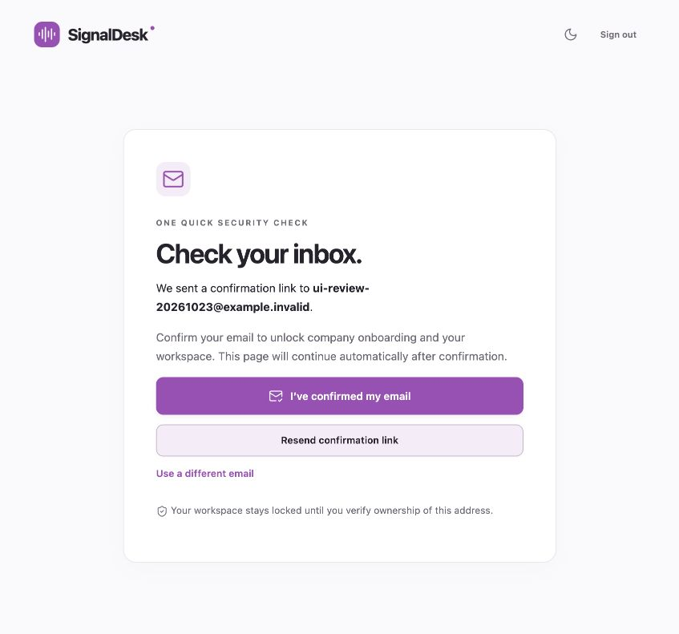
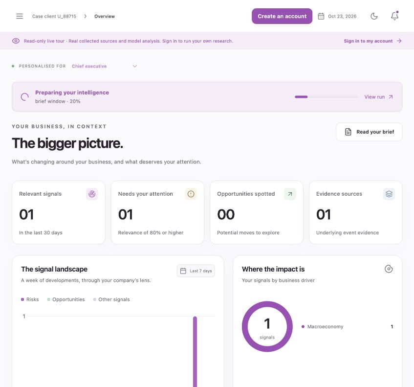
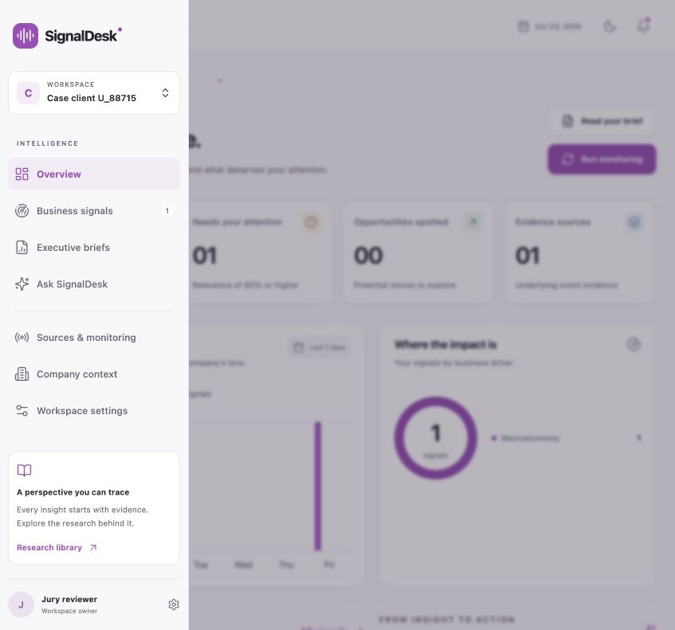
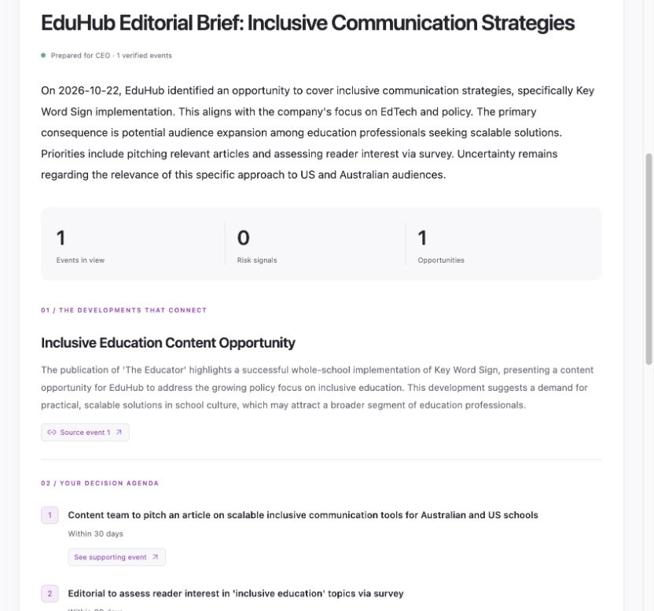

# SignalDesk 1.1 screenshot and journey audit

23 October 2026. Product Design audit using Codex's internal browser. The owner's supplied onboarding screenshot and a fresh capture of the previous public demo were the starting evidence. SubSchool's purple, system typography, neutral surfaces and rounded cards remain the visual foundation.

## Findings and changes

| Severity | Observed problem | Change and evidence |
|---|---|---|
| Critical | Registration could proceed into onboarding before email ownership was confirmed. | Dedicated inbox screen; direct product navigation redirects there and workspace APIs return 403. Confirmation resumes onboarding/invitation, including a different browser. |
| High | Public case entry looked like an unrestricted owner account. | Explicit read-only live-tour banner, register/sign-in CTAs, reduced navigation, disabled decision-role changes and server enforcement. Team emails, raw datasets, exports and mutations are blocked. |
| High | EduHub's US/AU context received fixed Russian news outlets. | Real discovery/verification with visible provenance and market gaps. Genuine specialist feeds are connected in the review workspace; the Australian source was researched and tested manually. No universal outlet fallback remains. |
| High | Synthetic events were used to populate the public demo. | The current tour reads genuine collected reporting and model analysis shared with the jury account. Synthetic generators are test-only and absent from the production image. Counts/charts/landing preview come from stored evidence. |
| Medium | An old geography question contradicted regions the user had just confirmed. | Confirmed regions resolve the stale question; model checks use confirmed structured fields. |
| Medium | A working RSS included old promotional posts or future webinar dates. | Freshness and future-date checks; source sampling, actual item counts and coverage diagnostics. Paused sources are labelled paused. |
| Medium | One publisher monopolised the high-score batch. | Source diversity preserves other relevant publishers before filling remaining slots. Live EduHub analysis includes US and Australian evidence. |
| Medium | A failed brief could leave generation busy; old failures remained after successful retry. | Busy state follows active jobs; a newer run supersedes the old banner. New evidence marks an older brief edition. |
| Medium | Conditional interpretations became categorical in some summaries and assistant answers transferred US policy to Australia. | Independent approved-model checking, bounded correction, explicit geographic limitations and source-bound citations. Unsupported output is withheld. |
| Medium | Selecting a case near the landing-page footer could retain the old scroll position and hide the new page header. | Route transitions reset to the top; browser-back restoration is retained. The browser check opens a footer case and asserts the new view starts at the top. |
| Medium | Full jury workspaces were also visible in the public tour without a clear publication label. | Owner view identifies the published review space and links to creating a private workspace. Ordinary new workspaces are private. |

## Inspected journey

1. Existing public demo captured before changes.
2. Sign in as a pending-email QA account → inbox screen → direct `/overview` attempt → inbox screen again.
3. Public live tour → real case-client overview → event reporting and dated bank research → confirm absent settings/analysis controls.
4. Ordinary password sign-in as jury → same three workspaces → full navigation/monitoring controls.
5. EduHub → connected sources and their actual collection counts → signals → period briefs → grounded question separated by US/Australia.
6. Public main and mirror rechecked after deployment; automated checks additionally exercise a 390px Russian mobile viewport, invitation/viewer permissions and independent operations.

## Screenshot evidence

All captures below are original internal-browser images, saved directly and inspected from disk. Playwright artifacts are separate test evidence and are not substituted for the Product Design captures.

Screenshots of the earlier 1.0 audit remain in the repository history and `output/design-audit/`. The revised working captures are under `output/revision-audit/`.

## Limits

The audit covers the observed journeys and viewports. Keyboard semantics and reflow are tested, but no formal screen-reader/device lab or WCAG certification is claimed. Generated language can still need correction; source fidelity, applicability and evidence gaps matter more than a polished but unsupported answer. The underlying content-quality and operational follow-up process is recorded in [QUALITY.md](QUALITY.md).

## Webinar follow-up, version 1.2

A fresh native-browser capture of `/alfa-business` showed that the old integration entry left the banking context and rendered a single preview in an unnecessarily narrow two-column slot. The revised journey keeps the banking identity through company selection, the signal feed and event analysis. The preview uses available width. A labelled company selector works with the browser accessibility tree; automated replay also covers bank home, briefs and switching.

The event review exposed percent notation for an editorial relevance score. Cards, drawer, alerts, landing preview and attention threshold now use points out of 100; expandable definitions distinguish relevance, source support, probability and financial impact. Facts credit the source, conditional impact is marked as AI interpretation, the bank section is labelled as an AI summary or missing coverage, and the non-investment-recommendation notice is retained.

Fresh captures and the three-step report are under `output/revision-audit/webinar/`. The review is scoped to the observed bank home → EduHub feed → source/conditional-impact drawer; it is not a screen-reader certification. The framework was Product Design audit; the capture surface was Codex’s internal browser, with actual published data.

A manual reload exposed a startup route watcher that cleared the saved bank mode while Vue Router still reported its initial `/` placeholder. The bank-mode transition now follows completed route navigation, and the browser scenario reloads the feed before opening briefs. This prevents a refresh from returning the user to the standalone shell.
