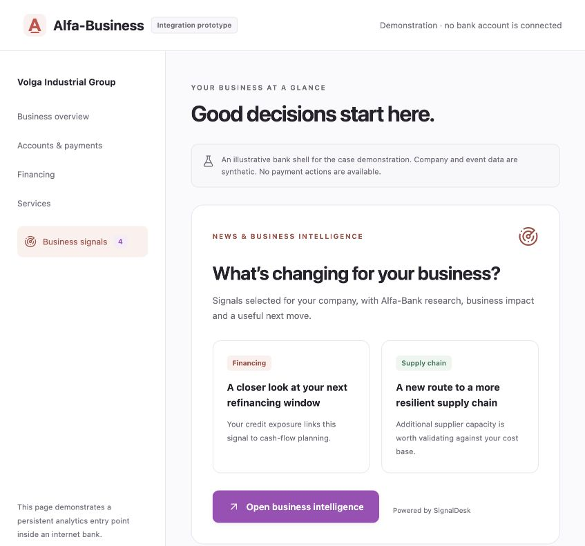
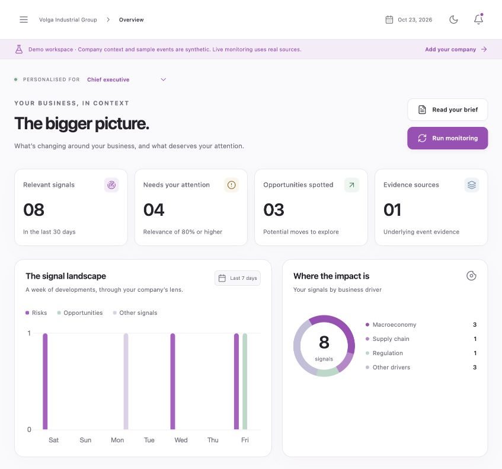
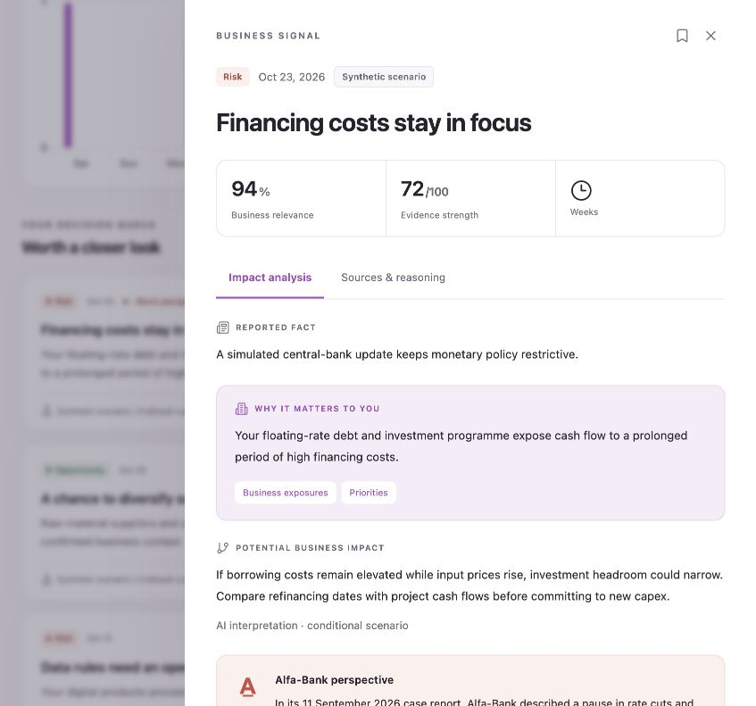
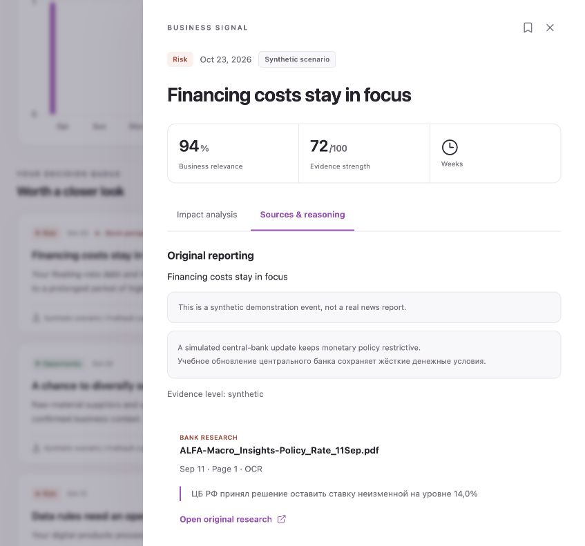
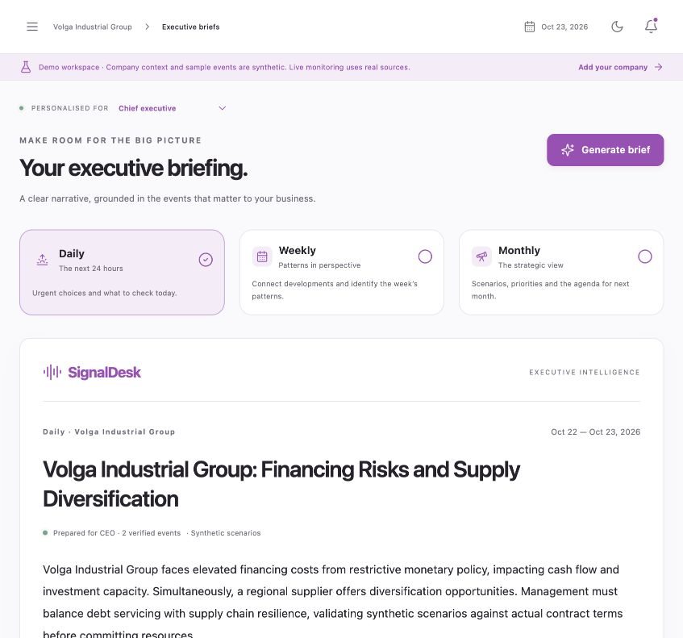
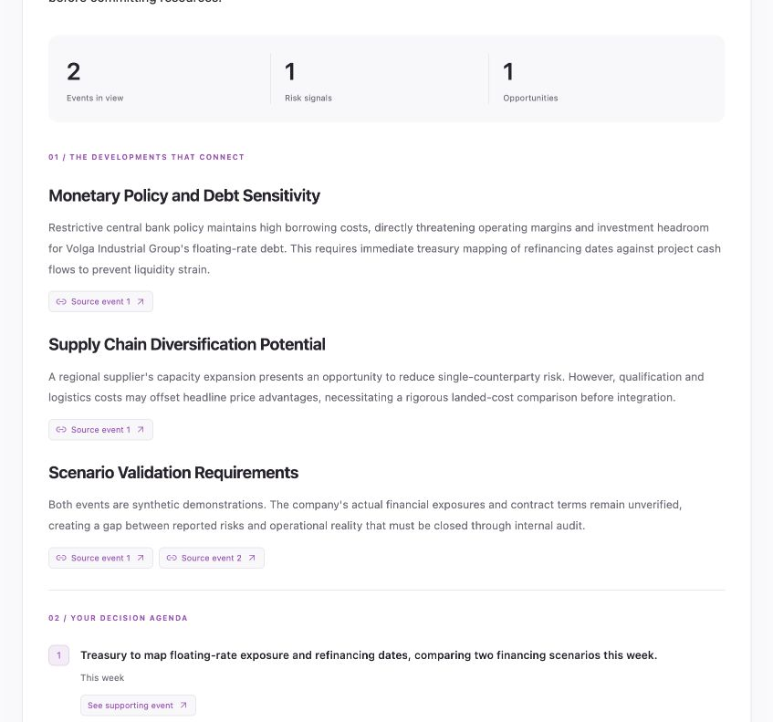

# SignalDesk screenshot audit

23 October 2026. Product Design audit of the implemented experience, using the Codex internal browser. The task was to make the existing working product clearer and easier to use. SubSchool's purple, typography and surface conventions remain the visual foundation.

## Journey and health after changes

1. **Bank-shell entry — clear.** The persistent Business signals entry and primary action open the product. An explicit integration-prototype label and demonstration notice prevent the shell from implying a real connected bank account.
2. **Overview — improved.** At the actual 847px internal-browser viewport, the sidebar now collapses and the metrics/charts have useful reading width. Category counts and donut segments share the same data. The decision queue leads to a specific action and its reasoning.
3. **Event → evidence — clear.** Reporting, company relevance, conditional impact, dated bank view, suggested action and uncertainty have distinct sections. The second tab shows the original PDF, page and exact selected quote. The evidence score is labelled `/100`, avoiding a misleading probability interpretation.
4. **Executive brief — usable.** Period selection, reporting dates, evidence count, narrative, linked themes and action agenda are readable. Previous editions and print/copy actions are available. The content remains visibly marked as synthetic when generated from the demonstration workspace.
5. **Monitoring, model and onboarding — functional.** Sources, exclusions, schedules and role thresholds are editable; the model defaults to the approved gateway. Website onboarding makes the review step and unknown financials explicit. Invitation controls in a demo explain why a real workspace is needed.

## Findings addressed

| Severity | Evidence/findings | Change and recheck |
|---|---|---|
| High | Ring chart displayed sentiment while its legend described business categories. | Both derive from category counts; the inspected overview shows 3/1/1/3 and a matching total of 8. |
| Medium | At 847px, a full sidebar compressed dashboard text and content. | Collapsible navigation starts at 1020px. Rechecked in the internal browser. |
| Medium | Muted text and dark-theme primary text were hard to read. | Darkened muted colours, increased label sizes and corrected dark-theme button text. No blanket WCAG conformance claim. |
| Medium | Evidence strength looked like a statistical percentage. | Changed presentation to `/100`; relevance remains a company/role score. |
| Medium | A missing single-letter icon import rendered the close action incorrectly. | Fixed the X icon, accessible labels and initial backward-tab focus handling. Rechecked the drawer and evidence tab. |
| Medium | The added chart-data table caused horizontal overflow on a 390px viewport. | Put the screen-reader table inside the visually hidden wrapper; deterministic and live mobile replays passed. |
| Medium | Large eager JavaScript bundle delayed initial loading. | Routes and chart code now load separately; main gzip size is about 59 kB. |

Initial captures are retained in ignored `output/design-audit/01-overview-before.png` through `03-evidence-before.png`. All images below are actual post-change internal-browser captures, saved without alteration and inspected from disk.

## Captured evidence

### 1. Bank entry

### 2. Overview after changes

### 3. Event interpretation

### 4. Dated, page-specific bank evidence

### 5. Generated daily brief

## Limits and follow-up

The screenshot audit covers the observed journey and viewport. Playwright separately covers desktop and 390px Russian mobile flows; those automation screenshots are QA evidence, not substituted internal-browser audit captures. Keyboard/focus semantics were improved, but no full screen-reader, browser/device matrix or formal accessibility audit was performed. AI language may still overstate urgency; evidence and assumptions remain exposed for review. A small case-model budget also limits the number of live repetitions.

No open blocker was found in the captured journey. For a production rollout beyond the hackathon, validate with actual decision makers, measure false positives over time, and test assistive technologies before making a formal accessibility claim.
